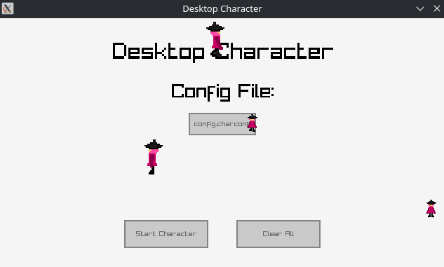
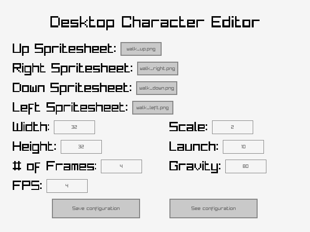

# desktop-character
A program built in SDL3 which displays a character moving around on your desktop and has an editor to configure the displayed character's animation.

This type of program is also known as a "desktop pet" or "shimeji" program.





# Running
Releases of the program are located on https://fractured-sky.itch.io/desktop-character.

For Windows, simply extract the files and run "out.exe" to start the main program.

For Linux, extract the files and run "out" to start the main program. If it does not start, then SDL3, SDL3_image, and Raylib may need to be installed onto the system through the system's package manager.

> **NOTE**: On **Arch Linux**, **SDL3_image** must be installed through the package manager as the bundled SDL3_image depends on `libjpeg.so.62` while Arch Linux provides `libjpeg.so.8`.  
Installing this package (`sdl3_image`) can be done by running `sudo pacman -S sdl3_image` in the terminal.

Further information can also be found in the provided README.txt file.


# Custom configurations
The main program allows any configuration file with the **.charconf** file extension to be selected. At most **5 characters** can be ran at once.

A configuration editor is provided and can be ran by running "editor" or "editor.exe" in the extracted files. Configurations are saved to **config.charconf** under the current directory, possibly overwriting prior data.


# Building
The main program and editor program were built using SDL3, SDL3_image, Raylib, and Raygui.

If any of these libraries are not installed on the system, they can be placed under thirdparty/include (header files) or thirdparty/lib (shared library files) which will be included when building.

The main program under src/ has its main loop located in src/anim.c. The GUI for the main loop is located in src/main_runner.c.

The editor program under src/config_editor has its main loop located in src/config_editor/main.c.


## CMake
CMake with GCC is the primary way to build the project into the build/ directory.

Main program and editor:
```sh
mkdir build
cmake -B build/
cmake --build build/
```

Specific targets can be specified using the `--target` option:
- Main program: `--target=out`
- Editor: `--target=editor`

Additional flags can also be specified when creating the build directory:
- Enable debug flags: `-DRELEASE=FALSE`
- Use nearest scaling for older versions of SDL3: `-DUSE_NEAREST_SCALEMODE=TRUE`


## Makefile
Make with GCC can also be used to build the project into the build/ directory.

Main program:
```sh
mkdir build
make release # or devel for debug flags
```

Editor program:
```sh
mkdir build
make editor_release # or editor for debug flags
```
